# EasyBau

**Die Betriebssoftware für Bau- und Handwerksbetriebe – Open Source, auf dem eigenen Server.**

Kunden, Projekte, Angebote mit Kalkulation, Aufmaß, Bautagebuch, Nachträge, GoBD-konforme Rechnungen mit E-Rechnung (ZUGFeRD/XRechnung), Zahlungen und Mahnwesen, Eingangsrechnungen und die Exporte für Steuerberater (DATEV) und Betriebsprüfung (GoBD Z3) – in einer Web-App, die im Büro am Rechner und auf der Baustelle am Handy läuft, dort auch ohne Netz.

Sie betreiben EasyBau selbst mit `docker compose` – ohne Abo, ohne Cloud-Zwang, mit Ihren Daten auf Ihrem Server.

<p>
  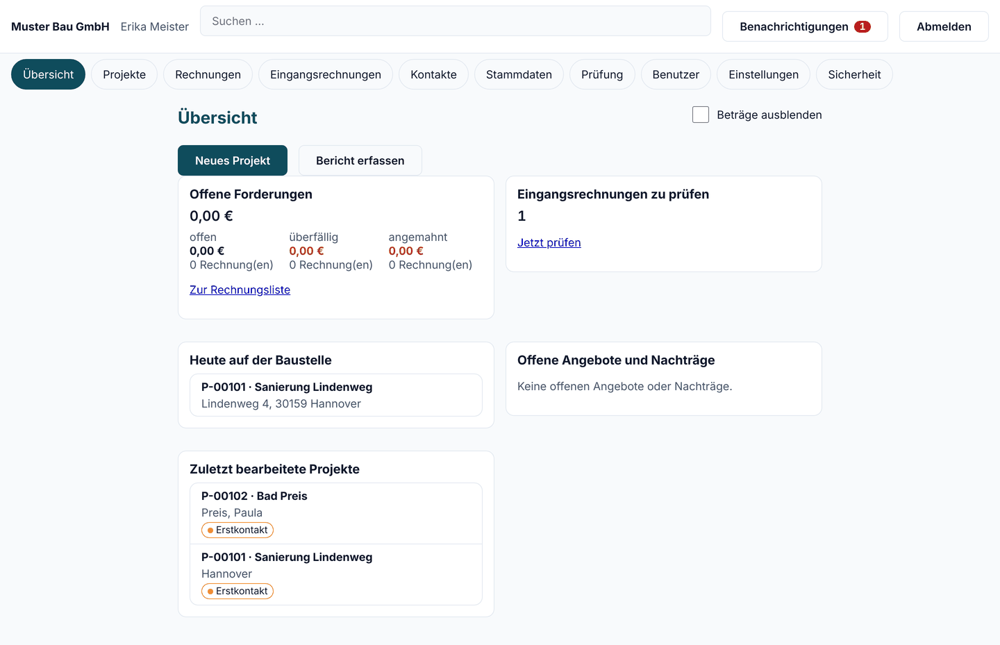
  &nbsp;
  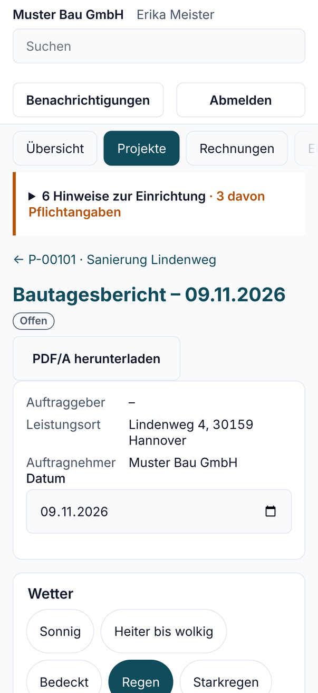
</p>

## Was EasyBau kann

| Bereich | Funktionen |
|---|---|
| **Angebot & Auftrag** | Leistungsverzeichnis mit Titeln, Pauschal-, Bedarfs- und Alternativpositionen, Bildern · Kalkulation je Position (Lohn, Material, Gerät, Fremdleistung) · Zielpreis · Versionen · Stammdaten mit DATANORM · Briefpapier nach DIN 5008 mit Editor · Versand per E-Mail |
| **Baustelle** | Aufmaß mit Formeln, Räumen und gemeinsamem Aufmaß · Bautagebuch mit Wetter, Personal, Fotos · Regie-, Einsatz- und Abnahmeberichte, Bedenken- und Behinderungsanzeige · Unterschrift auf dem Gerät · **offline** mit Übertragung, sobald wieder Netz da ist |
| **Nachträge** | Nachtragsangebote mit Nachweisen · Nachtrag aus Mehrmengen · (Teil-)Beauftragung · Vertragssumme je Projekt |
| **Rechnungen** | Abschlags-, Teil- und Schlussrechnung mit Abschlagsaufstellung · Mengen aus dem Aufmaß · Regieberichte übernehmen · Festschreiben mit § 14-Prüfung · **E-Rechnung** (ZUGFeRD EN 16931, XRechnung) geprüft mit KoSIT · Storno ohne Nummernlücke · GiroCode |
| **Forderungen** | Zahlungen, Skonto, Einbehalte, Kürzungen · Rechnungsliste · Zahlungserinnerung und Mahnungen mit Verzugszinsen · Mahnlauf |
| **Eingangsrechnungen** | Upload oder automatisch aus dem E-Mail-Postfach (IMAP, Microsoft 365, Google Workspace) · E-Rechnungen werden gelesen · Kosten auf Projekte und Betriebsbereiche · Projektkosten und Deckungsbeitrag |
| **Steuer & GoBD** | Unveränderbare Belege, revisionssicheres Archiv (S3 Object Lock) · Änderungsprotokoll mit Hash-Kette · DATEV-Export · GoBD-Datenträgerüberlassung · befristeter Prüferzugang |
| **Betrieb** | Nächtliche Sicherung, optional **verschlüsselt außer Haus** (restic) · Betriebs-Check · Anmeldung mit zweitem Faktor, Passkeys und Sicherheitsschlüsseln · Rollen für Büro, Bauleitung, Baustelle und Steuerberatung |

## Einblicke

| Angebot mit Kalkulation | Druckansicht nach DIN 5008 |
|---|---|
| 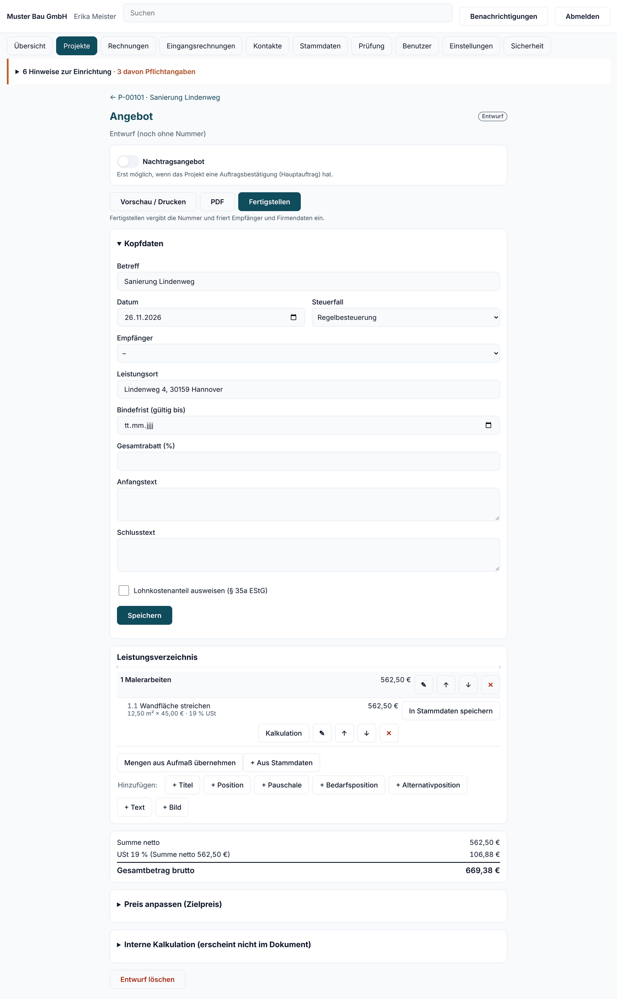 | 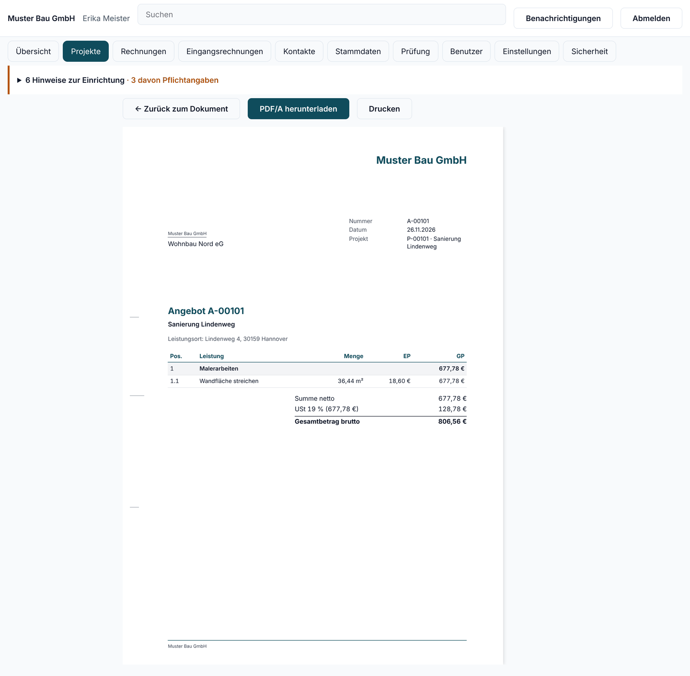 |
| **Rechnung festschreiben** | **Rechnungen und Forderungen** |
| 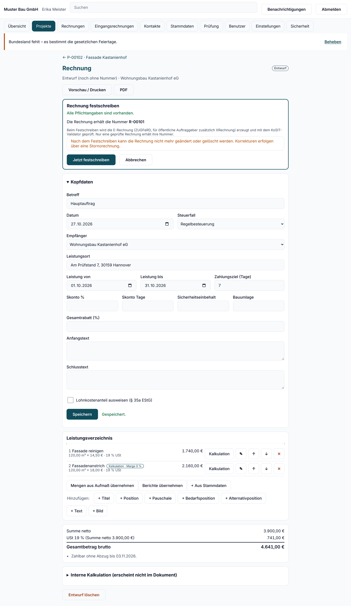 | 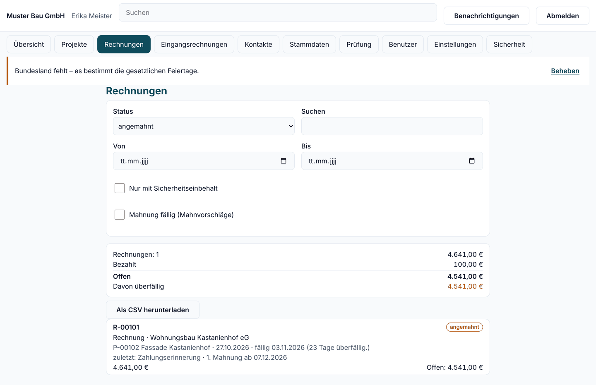 |
| **Eingangsrechnung prüfen** | **Projektkennzahlen** |
| 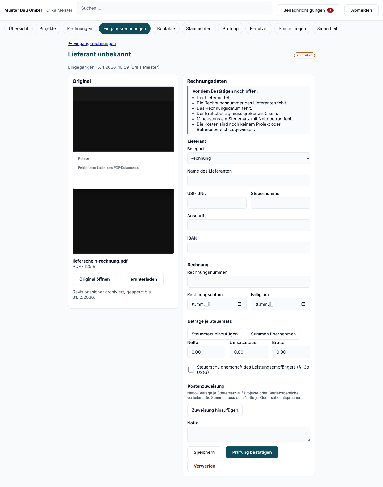 | 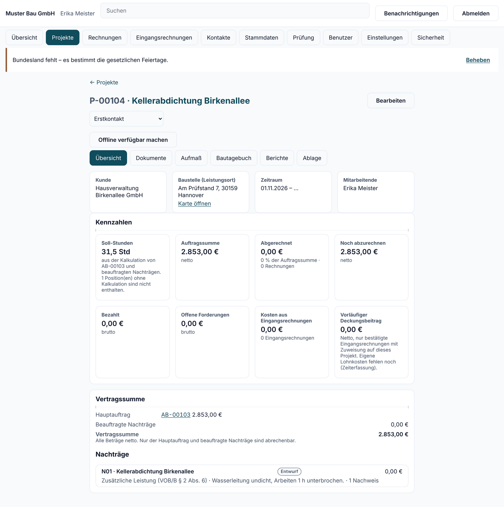 |

| Aufmaß | Bericht | Offline | Unterschrift |
|---|---|---|---|
| 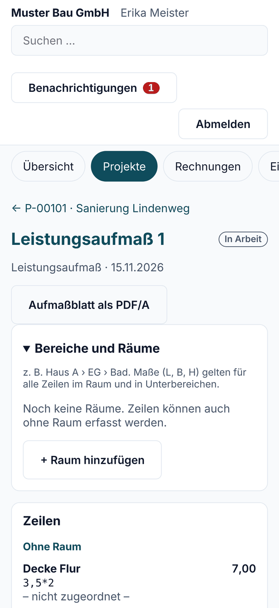 | 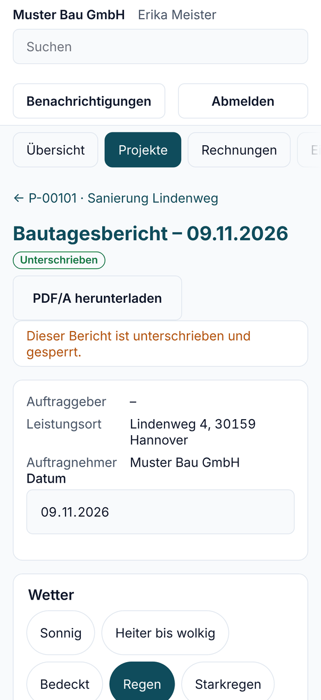 | 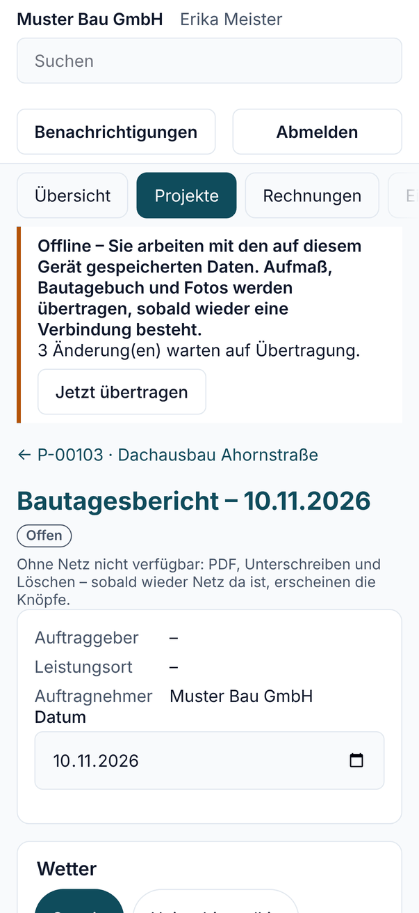 | 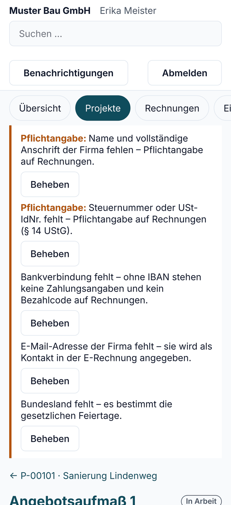 |

Alle Oberflächen: [Benutzerhandbuch](docs/handbuch/README.md).

## Schnellstart

Voraussetzung: ein Server (oder Rechner) mit Docker und mindestens 2 GB RAM.

```bash
git clone https://github.com/VIONYT/OpenPlancraft.git easybau && cd easybau
cp .env.example .env        # POSTGRES_PASSWORD und APP_SECRET setzen, für einen Server APP_DOMAIN
docker compose up -d
docker compose logs app | grep Einrichtungscode
```

Danach ist EasyBau unter `https://localhost` bzw. Ihrer Domain erreichbar (Caddy holt das Zertifikat automatisch). Die Ersteinrichtung fragt nach dem Einrichtungscode, dem Firmennamen und Ihrem Konto.

Wichtig für den Echtbetrieb:

- Die **`.env` getrennt sichern** – ohne denselben `APP_SECRET` sind Zwei-Faktor-Geheimnisse und IBAN nach einer Wiederherstellung nicht lesbar.
- Die **Sicherung außer Haus** einrichten (`RESTIC_REPOSITORY` in der `.env`). Der Betriebs-Check warnt, solange sie fehlt.
- Optional: E-Mail-Versand (SMTP), Rechnungseingang per E-Mail, externer S3 für das Belegarchiv.

Alles Weitere: [Betriebsdokumentation](docs/self-hosting/README.md).

## Dokumentation

| Für | Dokument |
|---|---|
| Anwender im Büro und auf der Baustelle | [Benutzerhandbuch](docs/handbuch/README.md) – auch als Website mit Suche: <https://vionyt.github.io/OpenPlancraft/> (GitHub Pages, sobald freigeschaltet) |
| Betreiber (Installation, Updates, Sicherung, Wiederherstellung) | [Betriebsdokumentation](docs/self-hosting/README.md) |
| Entwickler | [DESIGN.md](DESIGN.md) (Architektur, Datenmodell, UX) · [CLAUDE.md](CLAUDE.md) (Regeln, Konventionen, offene Punkte) · [Architekturentscheidungen](docs/adr/) · [CHANGELOG](CHANGELOG.md) |
| Hintergrund | [docs/RESEARCH.md](docs/RESEARCH.md) – Markt und Recht (GoBD, E-Rechnung, VOB/B) |

## Entwicklung

Stack: TypeScript, Fastify, PostgreSQL 17, React 19 + Vite (PWA), Typst für PDF/A, KoSIT-Validator, RustFS (S3 mit Object Lock), Caddy, Docker Compose.

Voraussetzungen: Node 26 (siehe `.nvmrc`), pnpm in der Version aus `package.json` → `packageManager` (`npm install -g pnpm@10.28.0`), Docker.

```bash
pnpm install
docker compose -f compose.yaml -f compose.dev.yaml up -d db kosit
DATABASE_URL=postgres://openplancraft:<passwort>@localhost:5432/openplancraft KOSIT_URL=http://localhost:8081 pnpm dev
```

```bash
pnpm lint && pnpm typecheck && pnpm test                    # vor jedem Commit
docker compose -f compose.test.yaml run --rm --build test   # komplette Testpipeline wie in der CI
```

E2E-Tests (Playwright) gegen einen laufenden Stack, auch als Screenshot-Rundgang für MacBook und iPhone: siehe [CLAUDE.md](CLAUDE.md#befehle).

## Mitmachen

Fehler und Wünsche bitte als [Issue](../../issues/new/choose) – es gibt Vorlagen für Fehlerberichte, Funktionswünsche und Fragen. Pull Requests sind willkommen; die Vorlage fragt nach Tests, Migrationen und den Compliance-Regeln (GoBD, Mandantentrennung). Sicherheitslücken bitte nicht öffentlich melden, sondern wie in der Issue-Auswahl beschrieben.

## Lizenz

[AGPL-3.0-or-later](LICENSE). Sie dürfen EasyBau nutzen, anpassen und weitergeben; wer eine veränderte Fassung als Dienst über das Netz anbietet, muss den Quellcode der Änderungen veröffentlichen.
