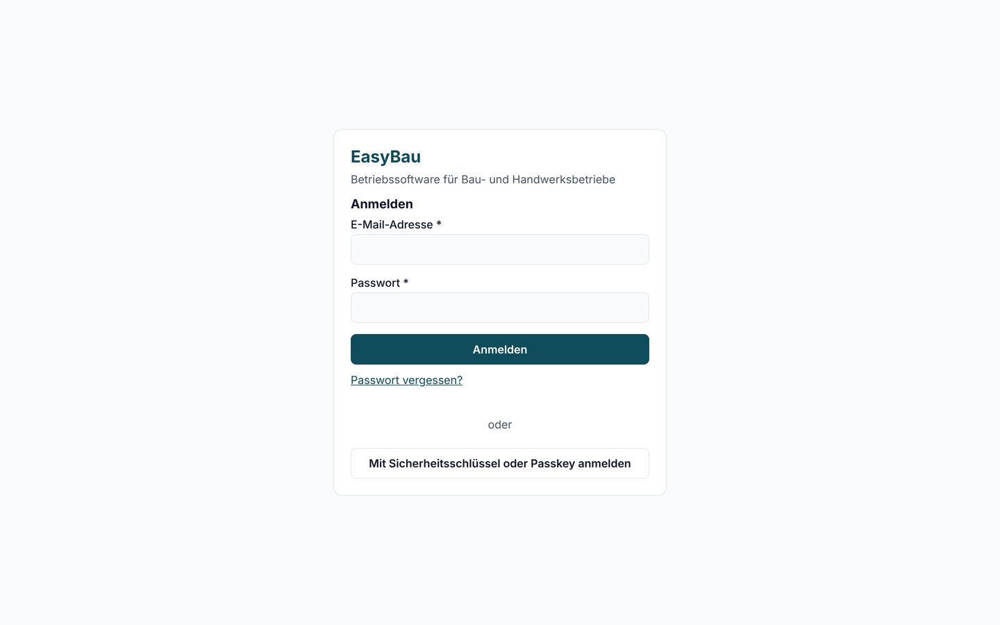
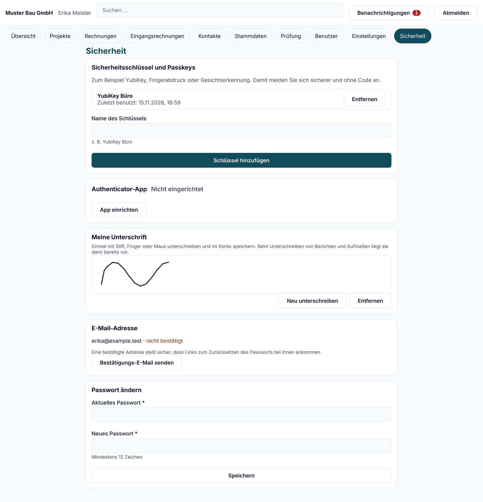
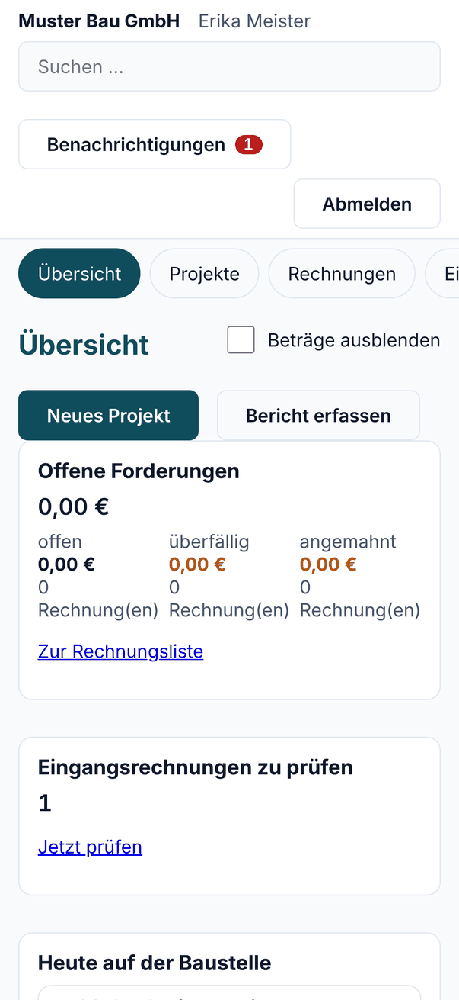

# 1. Erste Schritte

## Anmelden

Öffnen Sie die Adresse, die Ihnen Ihr Administrator genannt hat (z. B. `https://easybau.ihre-firma.de`), im Browser – am Rechner oder auf dem Handy.

1. E-Mail-Adresse und Passwort eingeben, **Anmelden**.
2. Wenn Sie einen zweiten Faktor eingerichtet haben, folgt der **Zweite Schritt**: Code aus der Authenticator-App eingeben oder **Mit Sicherheitsschlüssel bestätigen** (YubiKey, Fingerabdruck, Face ID).
3. Mit einem eingerichteten Passkey geht es auch ohne Passwort: **Mit Sicherheitsschlüssel oder Passkey anmelden**.

**Passwort vergessen?** Unter dem Anmeldeformular einen Link anfordern. Er kommt per E-Mail und gilt 30 Minuten. Ist kein E-Mail-Versand eingerichtet, erstellt ein Administrator unter **Benutzer › Passwort-Link** einen Link zum persönlichen Übergeben.

### App auf dem Handy installieren

EasyBau ist eine Web-App (PWA). Auf dem iPhone in Safari **Teilen › Zum Home-Bildschirm**, auf Android im Browser-Menü **App installieren**. Danach startet EasyBau wie eine App – und funktioniert auf der Baustelle auch ohne Netz (Kapitel 7).

## Zweiter Faktor (Pflicht für Administratoren)

Unter **Sicherheit**:

- **Schlüssel hinzufügen** – Sicherheitsschlüssel (YubiKey) oder Passkey des Geräts (Fingerabdruck, Face ID, Windows Hello).
- **App einrichten** – QR-Code mit einer Authenticator-App (z. B. Aegis, Google Authenticator, 1Password) scannen und den Code bestätigen.
- **Meine Unterschrift** – einmal mit Finger, Stift oder Maus unterschreiben; EasyBau setzt sie später in Berichte und Aufmaßblätter ein.

Administratoren müssen einen zweiten Faktor einrichten, bevor sie weiterarbeiten können. Verlieren Sie Schlüssel und Handy, setzt ein anderer Administrator unter **Benutzer › 2FA zurücksetzen** zurück.

## Hoher Kontrast

Unter **Sicherheit › Darstellung** schalten Sie für dieses Gerät einen **hohen Kontrast** ein – dunklere Schrift und Rahmen, gut lesbar bei Sonnenlicht auf der Baustelle. „Wie im Betriebssystem eingestellt“ folgt der Kontrast-Einstellung von iOS, Android, Windows oder macOS.

## E-Mail-Adresse ändern und Sicherheitshinweise

Unter **Sicherheit › E-Mail-Adresse › E-Mail-Adresse ändern** die neue Adresse und Ihr aktuelles Passwort eingeben. EasyBau schickt einen Link an die **neue** Adresse (24 Stunden gültig); erst nach der Bestätigung melden Sie sich damit an. Ihre bisherige Adresse bekommt sofort einen Hinweis. Ohne eingerichteten E-Mail-Versand gilt die neue Adresse sofort (dann als „nicht bestätigt“).

Mit eingerichtetem E-Mail-Versand bekommen Sie außerdem eine E-Mail, wenn

- Ihr Passwort geändert oder zurückgesetzt wurde,
- sich jemand mit Ihrem Zugang von einem **neuen Gerät** (Browser) angemeldet hat – das erste Gerät nach dem Einrichten zählt nicht,
- Ihre E-Mail-Adresse geändert wurde (an die alte Adresse).

Waren Sie das nicht, ändern Sie sofort Ihr Passwort (oder nutzen **Passwort vergessen**) und informieren Sie die Administration.

## Aufbau der Oberfläche

- **Kopfzeile:** Firmenname, Ihr Name, die **Suche** über alles (Projekte, Kontakte, Dokumente, Stammdaten, Eingangsrechnungen), **Benachrichtigungen** und **Abmelden**.
- **Hauptbereiche:** Übersicht · Projekte · Rechnungen · Eingangsrechnungen · Kontakte · Stammdaten · Prüfung · Benutzer · Einstellungen · Sicherheit. Sie sehen nur die Bereiche, für die Ihre Rolle Rechte hat.
- **Hinweisleiste** (gelb): fehlende Firmendaten, eine abgelaufene Postfach-Anmeldung o. Ä. – mit **Beheben** springen Sie direkt an die richtige Stelle.

## Übersicht (Startseite)

- **Offene Forderungen** – offen, überfällig, angemahnt; mit **Beträge ausblenden**, wenn jemand mitliest.
- **Eingangsrechnungen zu prüfen**
- **Heute auf der Baustelle** – Ihre Projekte, die heute laufen; **Bericht erfassen** öffnet direkt das Bautagebuch.
- **Offene Angebote und Nachträge** und **Zuletzt bearbeitete Projekte**.

Ohne Netz zeigt die Übersicht die Baustellen und Projekte vom Gerät; Beträge erscheinen erst wieder mit Verbindung.

## Benachrichtigungen

EasyBau benachrichtigt Sie, wenn z. B. ein Bericht unterschrieben, ein Nachtrag beauftragt oder abgelehnt wurde oder eine Rechnung überfällig ist (nur mit Mahnrecht). Gelesene Benachrichtigungen werden nach 90 Tagen automatisch entfernt.
