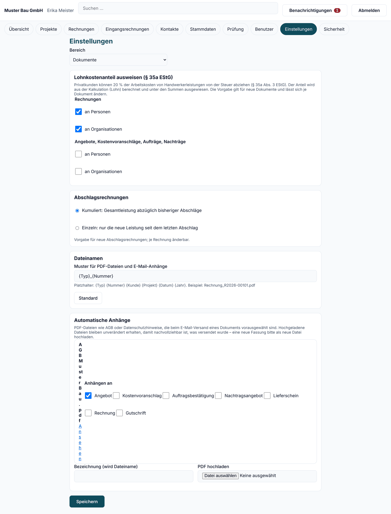
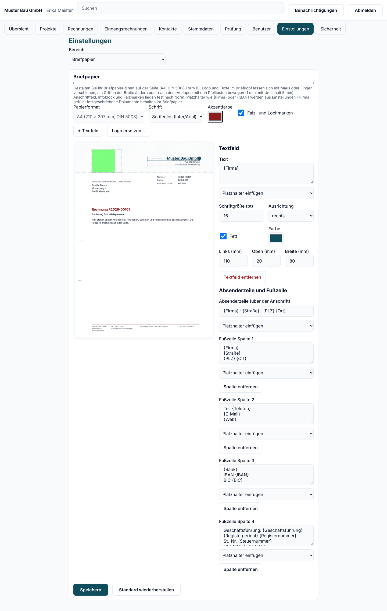
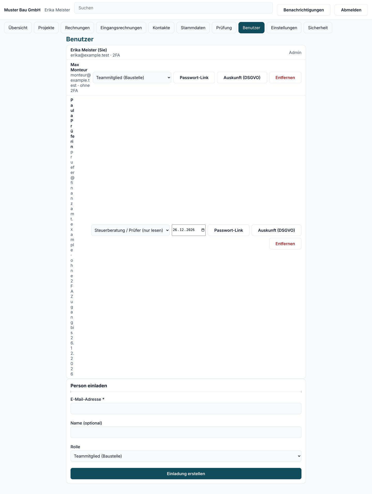

# 2. Einrichten

Die Einstellungen erreichen Sie über **Einstellungen**; der Bereich wird oben über die Auswahl **Bereich** gewechselt. Was fehlt und auf Rechnungen Pflicht ist, zeigt die gelbe Hinweisleiste – dort führt **Beheben** direkt zum Feld.

## Bei der Ersteinrichtung

Nach der Installation fragt EasyBau einmalig nach dem **Einrichtungscode** (vom Administrator aus der `.env`), dem Firmennamen mit Rechtsform und Ihrem Benutzerkonto. Danach richten Sie als Erstes den zweiten Faktor ein (Kapitel 1).

## Die wichtigsten Bereiche

| Bereich | Was Sie dort einstellen |
|---|---|
| **Firma** | Anschrift, Steuernummer bzw. USt-IdNr., Bankverbindung (IBAN), E-Mail, Bundesland (Feiertage). Ohne Anschrift und Steuernummer lässt sich keine Rechnung festschreiben (§ 14 UStG). |
| **Nummernkreise** | Muster für Angebote, Aufträge, Rechnungen usw., z. B. `R{JJ}-{Nummer}`, jährlich neu beginnend oder fortlaufend. Nummern werden lückenlos erst beim Festschreiben vergeben. |
| **Zahlungsbedingungen** | Zahlungsziel und Skonto; Standard für alle Kunden oder je Kunde im Kontakt. |
| **Steuersätze**, **Einheiten** | 19 %, 7 %, 0 % und § 13b sind vorhanden; Einheiten mit UN/ECE-Code für die E-Rechnung. |
| **Zuschläge**, **Lohngruppen** | Grundlage der Kalkulation: Kosten je Stunde und Zuschlag ergeben den Stundenverrechnungssatz. |
| **Arbeitszeiten**, **Feiertage** | Gesetzliche Feiertage Ihres Bundeslands werden berechnet; örtliche Feiertage tragen Sie selbst ein. |
| **Textbausteine** | Anfangs- und Schlusstexte für Dokumente. |
| **Dokumente** | Lohnkostenanteil nach § 35a ausweisen (Standard: Rechnungen an Privatpersonen), kumulierte oder einzelne Abschläge, Dateinamen der PDFs, automatische Anhänge (z. B. AGB) je Dokumentart. |
| **Briefpapier** | Briefkopf nach DIN 5008 Form B mit Logo, Absenderzeile und Fußzeile – direkt auf der Seite bearbeiten (unten). |
| **Ablage** | Ordnervorlage für neue Projekte (z. B. Pläne, Fotos, Verträge). |
| **DATEV** | Kontenrahmen SKR03/SKR04, Berater- und Mandantennummer, Erlös- und Aufwandskonten. |
| **Betriebsbereiche** | Kostenstellen außerhalb von Projekten (Lager, Fahrzeuge, Büro) für Eingangsrechnungen. |
| **E-Mail-Vorlagen** | Betreff und Text beim Versand von Dokumenten, mit Platzhaltern wie `{Nummer}` oder `{Betrag}`. |
| **Rechnungseingang (E-Mail)** | Postfach, aus dem Eingangsrechnungen automatisch abgeholt werden (Kapitel 10). |
| **Mahnungen** | Fristen, Gebühren, Verzugszinsen und Texte der Mahnstufen. |
| **Betrieb** | Version, E-Mail-Test, Postausgang und der **Betriebs-Check** (Kapitel 11). |

## Briefpapier gestalten

**Einstellungen › Briefpapier** zeigt eine echte A4-Seite. Tippen Sie ein Element an, um es zu bearbeiten:

- **Logo hochladen …** und mit der Maus oder dem Finger an die richtige Stelle ziehen,
- **+ Textfeld** für eigene Zeilen, mit **Platzhalter einfügen** für Firmenname, Anschrift, Telefon usw.,
- **Absenderzeile** über dem Anschriftfeld und bis zu vier **Fußzeilen-Spalten** (Bank, Steuernummer, Geschäftsführung …),
- Schrift, Akzentfarbe, Falz- und Lochmarken.

Die Vorschau entspricht dem späteren PDF (PDF/A). Festgeschriebene Rechnungen behalten das Briefpapier vom Tag des Festschreibens.

## Benutzer und Rollen

Unter **Benutzer › Person einladen** E-Mail-Adresse, Name und Rolle eingeben und **Einladung erstellen**. Der Einladungslink geht per E-Mail raus oder wird mit **Link kopieren** persönlich weitergegeben.

| Rolle | Darf |
|---|---|
| **Admin** | alles, inklusive Firma, Benutzer und Rollen |
| **Büroleitung** | wie Admin, aber ohne Firmendaten und Benutzerverwaltung: alle Projekte, Dokumente festschreiben und stornieren, Zahlungen, Mahnungen, Eingangsrechnungen, Exporte, Prüfung |
| **Projektleitung** | eigene Projekte, Kontakte, Dokumente bearbeiten (nicht festschreiben), Aufmaß, Berichte; Eingangsrechnungen lesen |
| **Teamleitung (Baustelle)** | Aufmaß, Bautagebuch und Berichte der eigenen Projekte, unterschreiben – ohne Preise |
| **Teammitglied (Baustelle)** | Aufmaß, Bautagebuch und Berichte der eigenen Projekte – ohne Preise |
| **Steuerberatung / Prüfer (nur lesen)** | alles lesen und exportieren, **befristet** (höchstens ein Jahr), keine Änderungen |

**Auskunft (DSGVO)** lädt alle zu einer Person gespeicherten Daten als Datei herunter (jede Person kann das für sich selbst unter **Sicherheit › Meine Daten**). **Entfernen** nimmt die Person aus der Firma; gehört sie danach zu keiner Firma mehr, werden ihre Anmeldedaten (Passwort, zweiter Faktor, Passkeys, Geräte, E-Mail-Adresse) gelöscht – ihr Name bleibt im Änderungsprotokoll.

