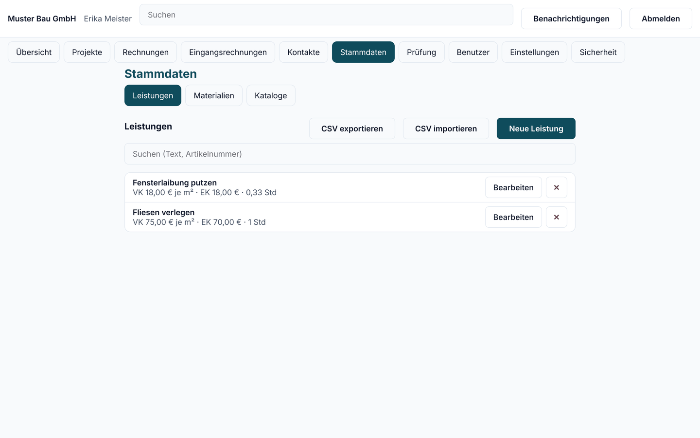

# 3. Kontakte und Stammdaten

## Kontakte

**Kontakte** enthält Kunden, Lieferanten, Architekten, Subunternehmer – Organisationen und Personen. Ein Kontakt mit Kundennummer ist ein Kunde.

- **Neuer Kontakt:** Organisation oder Person wählen, Namen eingeben, **Speichern**. Danach öffnet sich der Kontakt zum Vervollständigen.
- **Rechnungsanschrift**, **E-Mail und Telefon** (beliebig viele), **Abweichender Rechnungsempfänger** (z. B. Hausverwaltung statt Eigentümer) und **Weitere Anschriften** (Lieferanschrift, sonstige). Im Dokumentkopf wählen Sie unter **Anschrift**, welche Anschrift ein Dokument bekommt (Standard: Rechnungsempfänger, sonst Hauptanschrift).
- **Ansprechpartner:** Personen mit **+ Organisation** verknüpfen, z. B. „Klara Klee – Buchhaltung bei Hausverwaltung Klee GmbH“.
- **Steuer:** USt-IdNr. (Pflicht bei § 13b), **E-Rechnung:** Format (ZUGFeRD, XRechnung UBL/CII) und **Leitweg-ID** für öffentliche Auftraggeber.
- **Zahlungsbedingung** je Kunde, **Kreditorennummer** für Lieferanten (DATEV).
- **Archivieren** statt löschen – archivierte Kontakte bleiben in alten Belegen erhalten.
- **Farbe** zum Markieren; in der Liste filtern Sie über die Farbfelder.
- Der **Ansprechpartner** („z. Hd.“) eines Dokuments steht auch in der E-Rechnung (Ansprechpartner des Käufers).

Jeder geöffnete Kontakt hat eine eigene Adresse (`/kontakte/…`), die Sie z. B. als Lesezeichen speichern können.

**CSV importieren / exportieren:** Kontakte aus einem anderen Programm übernehmen (Vorschau vor dem Import, Dubletten werden erkannt) oder für Serienbriefe exportieren. Neben Name, Anschrift und Kommunikation kennt die Datei die Spalten **Zahlungsbedingung** (Name wie in den Einstellungen), **Farbe** (`#2E7D32`), **Rechnung Empfänger/Straße/PLZ/Ort/Land** (abweichender Rechnungsempfänger, Zeilen im Empfänger mit `|` trennen) und **Funktion** (Rolle eines Ansprechpartners). Am einfachsten exportieren Sie einmal und nutzen die Datei als Vorlage.

### Dubletten zusammenführen

Gibt es einen Kunden doppelt, öffnen Sie die Dublette und wählen **Mit anderem Kontakt zusammenführen** und den Kontakt, der bleiben soll. Projekte, Entwürfe, Ansprechpartner, Eingangsrechnungen in Prüfung sowie fehlende Telefonnummern, E-Mail-Adressen und Anschriften wandern zum bleibenden Kontakt; hat er noch keine Kunden- oder Kreditorennummer, übernimmt er die der Dublette. Festgeschriebene Dokumente behalten ihren Empfänger (GoBD). Die Dublette wird archiviert, zeigt „Zusammengeführt mit …“ und lässt sich nicht mehr verwenden. Wird der bleibende Kontakt später aus Datenschutzgründen gelöscht, werden die Dubletten mit erfasst. Zusammenführen geht nur zwischen Kontakten derselben Art (Person/Organisation) und lässt sich nicht rückgängig machen.

### Datenschutz: Auskunft und Löschen

Fragt ein Kunde nach seinen Daten oder verlangt die Löschung (DSGVO), finden Sie beides im Kontakt unter **Datenschutz**:

- **Auskunft herunterladen** erstellt eine Datei mit allem, was zu diesem Kontakt gespeichert ist: Stammdaten, Anschriften, Kommunikationswege, Projekte, Dokumente, Eingangsrechnungen, gesendete E-Mails sowie Zwecke, Rechtsgrundlagen und Speicherdauer. Die Datei können Sie dem Kunden übergeben (sie ist zugleich maschinenlesbar, Art. 20). Jede Auskunft wird im Änderungsprotokoll vermerkt.
- **Löschen (DSGVO)** zeigt zuerst, was passiert:
  - Steht der Kontakt in **keinem festgeschriebenen Beleg**, wird er sofort und endgültig anonymisiert (Name, Anschriften, Kommunikationswege und Verknüpfungen werden gelöscht).
  - Steht er in **Rechnungen oder anderen festgeschriebenen Belegen**, müssen diese aufbewahrt werden (§ 147 AO, § 257 HGB). Der Kontakt wird dann bis zum Ende der Aufbewahrungsfrist **gesperrt**: Er lässt sich nicht mehr ändern und nicht mehr für neue Projekte oder Dokumente verwenden. Am Tag nach Fristende löscht EasyBau ihn automatisch.

Festgeschriebene Belege selbst behalten ihre Empfängerdaten unverändert (GoBD). Die alten Werte des Kontakts werden auch aus dem Änderungsprotokoll entfernt. Bei **Privatkunden** verlieren deren Projekte Namen, Beschreibung und Baustellenanschrift und werden archiviert; Dateien, Fotos und Berichte in diesen Projekten nennt der Löschdialog – prüfen Sie sie in der Ablage und löschen Sie, was nicht mehr gebraucht wird.

## Stammdaten

**Stammdaten** sind Ihre wiederkehrenden **Leistungen** (mit Kalkulation aus Lohn, Material, Gerät, Fremdleistung) und **Materialien** (mit Einkaufspreis, Gebinde, Lieferant).

- **Neue Leistung** / **Neues Material** anlegen, in Ordnern sortieren.
- **Kataloge:** DATANORM-Dateien (Version 4 oder 5) Ihres Großhändlers importieren – Artikel, Preise, Langtexte, EAN, Rabattgruppen. Ein ZIP vom Großhändler zuerst entpacken, dann
  1. die Artikeldatei (meist `DATANORM.001`) als **neuen Katalog** importieren – der Katalog heißt dann wie der Lieferant,
  2. die Rabattdatei (`DATANORM.RAB`) **in diesen Katalog** importieren. Enthält sie keine Rabatte (0 %, wie bei vielen Herstellern – Ihre Konditionen sind individuell), tragen Sie Ihre Rabatte je Rabattgruppe unter **Bearbeiten** ein; eigene Werte werden von der Datei nie mit 0 % überschrieben,
  3. die Warengruppendatei (`DATANORM.WRG`) können Sie weglassen.
- **CSV importieren / exportieren** für Preislisten.
- Aus einem Angebot heraus: **In Stammdaten speichern** übernimmt eine gut kalkulierte Position mit ihrer Kalkulation.

Im Leistungsverzeichnis fügen Sie Stammdaten mit **+ Aus Stammdaten** ein.

