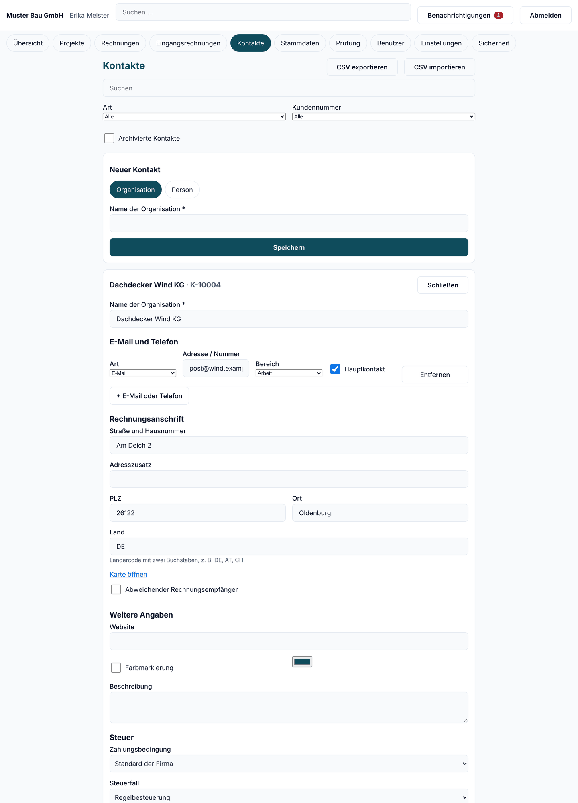

# 3. Kontakte und Stammdaten

## Kontakte

**Kontakte** enthält Kunden, Lieferanten, Architekten, Subunternehmer – Organisationen und Personen. Ein Kontakt mit Kundennummer ist ein Kunde.

- **Neuer Kontakt:** Organisation oder Person wählen, Namen eingeben, **Speichern**. Danach öffnet sich der Kontakt zum Vervollständigen.
- **Rechnungsanschrift**, **E-Mail und Telefon** (beliebig viele), **Abweichender Rechnungsempfänger** (z. B. Hausverwaltung statt Eigentümer).
- **Ansprechpartner:** Personen mit **+ Organisation** verknüpfen, z. B. „Klara Klee – Buchhaltung bei Hausverwaltung Klee GmbH“.
- **Steuer:** USt-IdNr. (Pflicht bei § 13b), **E-Rechnung:** Format (ZUGFeRD, XRechnung UBL/CII) und **Leitweg-ID** für öffentliche Auftraggeber.
- **Zahlungsbedingung** je Kunde, **Kreditorennummer** für Lieferanten (DATEV).
- **Archivieren** statt löschen – archivierte Kontakte bleiben in alten Belegen erhalten.

Jeder geöffnete Kontakt hat eine eigene Adresse (`/kontakte/…`), die Sie z. B. als Lesezeichen speichern können.

**CSV importieren / exportieren:** Kontakte aus einem anderen Programm übernehmen (Vorschau vor dem Import, Dubletten werden erkannt) oder für Serienbriefe exportieren.

## Stammdaten

**Stammdaten** sind Ihre wiederkehrenden **Leistungen** (mit Kalkulation aus Lohn, Material, Gerät, Fremdleistung) und **Materialien** (mit Einkaufspreis, Gebinde, Lieferant).

- **Neue Leistung** / **Neues Material** anlegen, in Ordnern sortieren.
- **Kataloge:** DATANORM-Dateien (Version 4 oder 5) Ihres Großhändlers importieren – Artikel, Preise, Langtexte, EAN, Rabattgruppen. Ein ZIP vom Großhändler zuerst entpacken, dann
  1. die Artikeldatei (meist `DATANORM.001`) als **neuen Katalog** importieren – der Katalog heißt dann wie der Lieferant,
  2. die Rabattdatei (`DATANORM.RAB`) **in diesen Katalog** importieren. Enthält sie keine Rabatte (0 %, wie bei vielen Herstellern – Ihre Konditionen sind individuell), tragen Sie Ihre Rabatte je Rabattgruppe unter **Bearbeiten** ein; eigene Werte werden von der Datei nie mit 0 % überschrieben,
  3. die Warengruppendatei (`DATANORM.WRG`) können Sie weglassen.
- **CSV importieren / exportieren** für Preislisten.
- Aus einem Angebot heraus: **In Stammdaten speichern** übernimmt eine gut kalkulierte Position mit ihrer Kalkulation.

Im Leistungsverzeichnis fügen Sie Stammdaten mit **+ Aus Stammdaten** ein.

