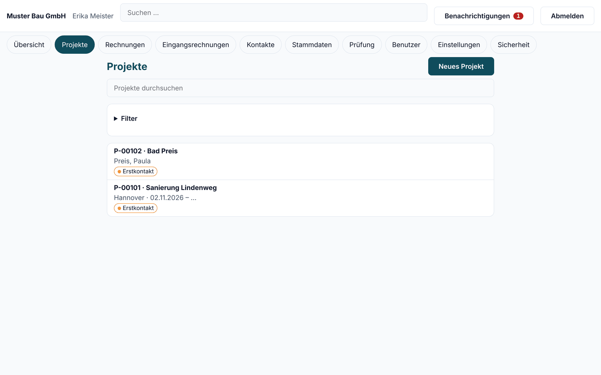
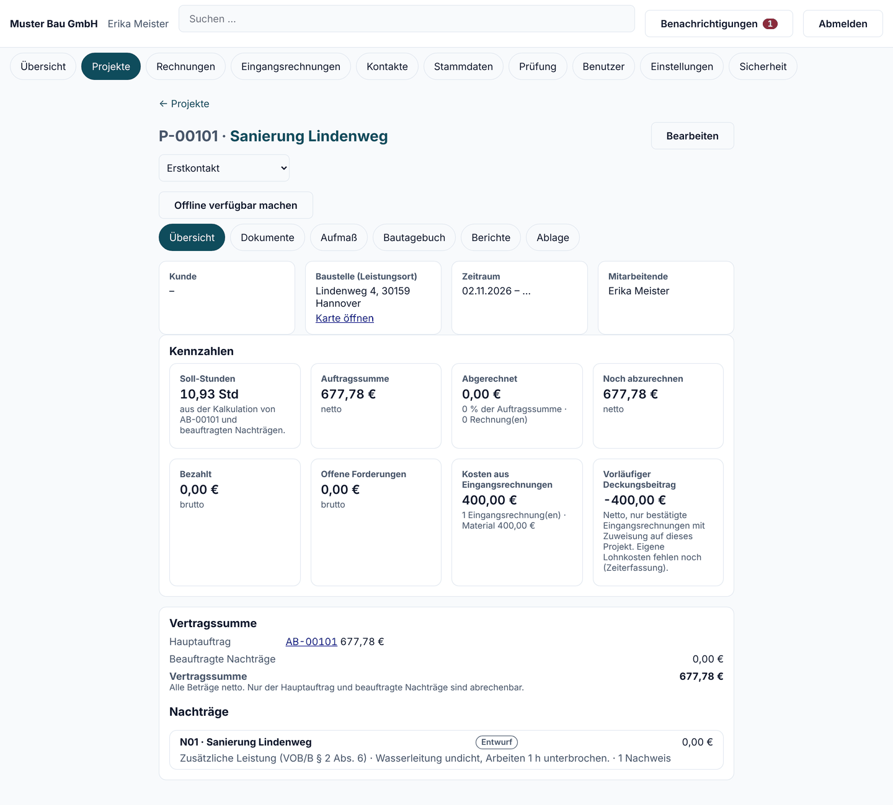
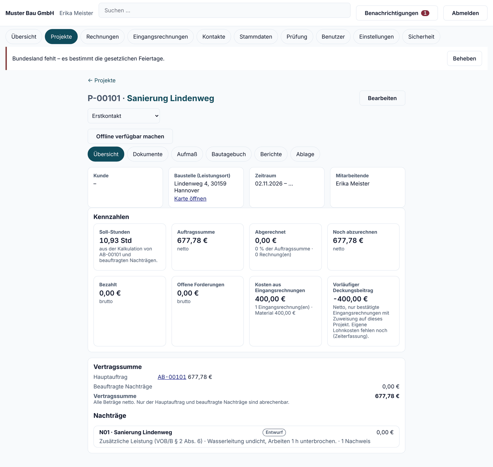

# 4. Projekte

Alles hängt am **Projekt** (der Baustelle): Dokumente, Aufmaß, Bautagebuch, Berichte und Dateien.

## Projekt anlegen

**Projekte › Neues Projekt:** Projektname, Kunde und Ort der Baustelle genügen. Unter **Weitere Angaben** folgen Anschrift der Baustelle (**Adresse des Kunden übernehmen**), Zeitraum, Status und Mitarbeitende. Die Projektnummer vergibt EasyBau automatisch.

Die Projektliste lässt sich nach Text, **Status**, **Zeitraum** und **Mitarbeitende** („Nur meine Projekte“) filtern.

## Im Projekt

Ein Projekt hat sechs Bereiche:

| Bereich | Inhalt |
|---|---|
| **Übersicht** | Kunde, Baustelle (mit **Karte öffnen**), Mitarbeitende, **Kennzahlen** und **Vertragssumme** |
| **Dokumente** | Angebote, Aufträge, Nachträge, Rechnungen, Gutschriften |
| **Aufmaß** | Angebots- und Leistungsaufmaß (Kapitel 6) |
| **Bautagebuch** | tägliche Bautagesberichte (Kapitel 7) |
| **Berichte** | Regieberichte, Abnahme, Bedenken- und Behinderungsanzeige (Kapitel 7) |
| **Ablage** | Pläne, Fotos, Verträge in Ordnern; **Foto aufnehmen** direkt mit der Handykamera |

### Kennzahlen

- **Soll-Stunden** aus der Kalkulation des Auftrags und der beauftragten Nachträge,
- **Auftragssumme**, **Abgerechnet**, **Noch abzurechnen**, **Bezahlt**, **Offene Forderungen**,
- **Kosten** aus bestätigten Eingangsrechnungen je Kostenart und ein vorläufiger **Deckungsbeitrag**.

### Vertragssumme

Hauptauftrag plus beauftragte Nachträge – und welche Nachträge angeboten, offen oder abgelehnt sind. Nur Positionen aus dem Hauptauftrag und beauftragten Nachträgen dürfen abgerechnet werden.

### Offline verfügbar machen

Vor dem Weg auf eine Baustelle ohne Netz: **Offline verfügbar machen** speichert das Projekt mit Aufmaß und Bautagebuch auf dem Gerät (Kapitel 7).
