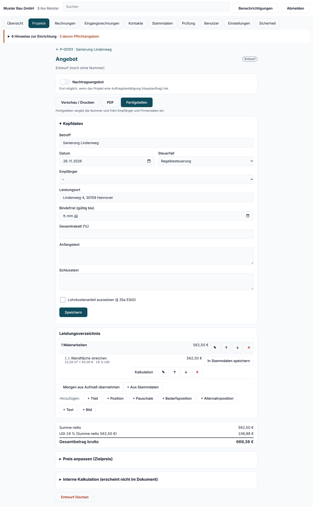
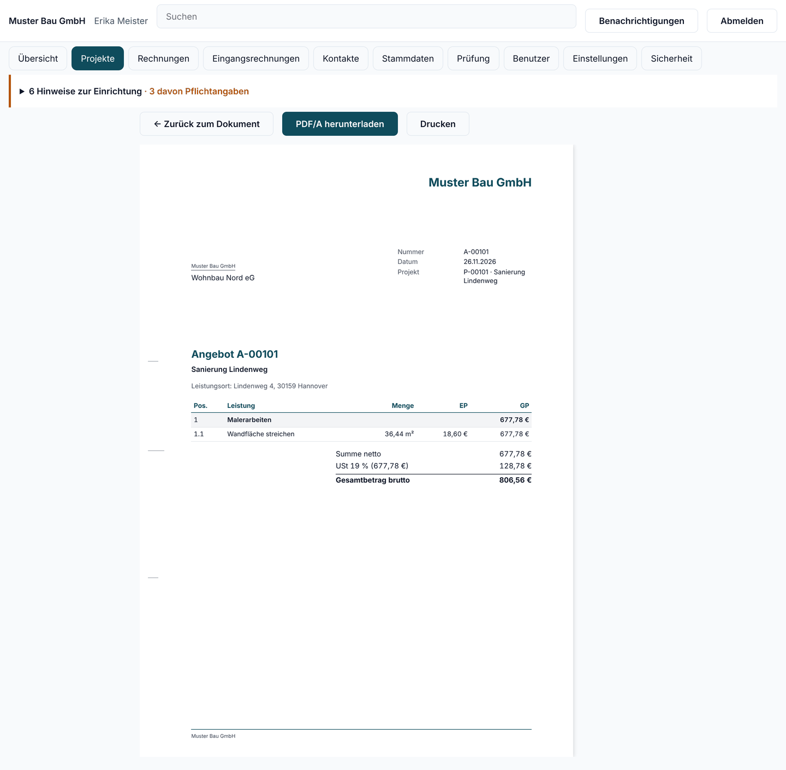

# 5. Angebot und Auftrag

## Dokument anlegen

Im Projekt unter **Dokumente › Neues Dokument** die Art wählen (Angebot, Kostenvoranschlag, Auftragsbestätigung, Rechnung, Gutschrift …). Mit **Positionen übernehmen aus** entsteht das Dokument aus einem vorhandenen – z. B. die Auftragsbestätigung aus dem Angebot oder die Rechnung aus der Auftragsbestätigung. **Dokument erstellen**.

## Kopfdaten

Unter **Kopfdaten**: Betreff, Datum, **Empfänger**, **Ansprechpartner (z. Hd.)** – eine Person, die im Kontakt der Organisation als Ansprechpartner verknüpft ist; sie steht als „z. Hd. …“ im Anschriftfeld –, Leistungsort, Bindefrist, Gesamtrabatt, **Steuerfall** (normal, § 13b, steuerfrei), Anfangs- und Schlusstext, **Lohnkostenanteil ausweisen (§ 35a EStG)**.

## Leistungsverzeichnis

Mit den Schaltflächen unter dem Leistungsverzeichnis fügen Sie hinzu:

- **+ Titel** – Gliederung (Ordnungszahlen 1, 1.1, 1.1.1 entstehen automatisch),
- **+ Position** – Kurztext, Langtext, Menge, Einheit, Einheitspreis,
- **+ Pauschale**, **+ Bedarfsposition**, **+ Alternativposition**, **+ Text**,
- **+ Aus Stammdaten** – Leistung oder Material aus den Stammdaten,
- **+ Bild** – ein Foto oder eine Skizze aus der Projektablage.

**Mengen aus Aufmaß übernehmen** setzt die Mengen der Positionen aus dem Angebotsaufmaß (Kapitel 6).

## Kalkulation

Bei jeder Position öffnet **Kalkulation** die Kostenzeilen: Lohn (Stunden × Lohngruppe), Material, Gerät, Fremdleistung, Sonstiges – jeweils mit Zuschlag. EasyBau berechnet daraus den Einheitspreis, die Marge und die Soll-Stunden. **Interne Kalkulation (erscheint nicht im Dokument)** zeigt die Summe für das ganze Angebot.

### Zielpreis

Der Kunde nennt ein Budget? **Preis anpassen (Zielpreis)** – gewünschten Nettobetrag eingeben, **Vorschau**, dann **Zielpreis übernehmen**. EasyBau passt die Zuschläge der kalkulierten Positionen an; Kosten bleiben gleich. Positionen unter den Kosten werden angezeigt.

## Fertigstellen, drucken, versenden

- **Vorschau / Drucken** zeigt die Seite auf dem Briefpapier.
- **Fertigstellen** vergibt die Nummer (z. B. `A-00101`) und friert Empfänger und Firmendaten ein. Danach ist das Dokument unveränderlich.
- **PDF** lädt das Original (PDF/A) herunter, **Per E-Mail senden** verschickt es mit Vorlage, CC/BCC und automatischen Anhängen.
- **Als versendet markieren**, später **Beauftragt** oder **Abgelehnt**.

### Versionen

Ändert sich ein fertiges Angebot, legt **Neue Version anlegen** eine bearbeitbare Kopie an. Beim Fertigstellen bekommt sie die Nummer mit Zusatz, z. B. `A-00101-V2`. In der Übersicht zählt nur die neueste Version als offenes Angebot. Sobald eine neuere Version fertiggestellt ist, gelten ältere als **ersetzt**: Eine Auftragsbestätigung oder ein anderes Folgedokument lässt sich nur noch aus der neuesten Version erstellen.

## Auftragsbestätigung (Hauptauftrag)

Nach der Beauftragung: **Neues Dokument › Auftragsbestätigung**, **Positionen übernehmen aus** dem Angebot, **Fertigstellen**. Die Auftragsbestätigung ist der Hauptauftrag des Projekts – Grundlage für Nachträge, Aufmaß und Rechnungen.
