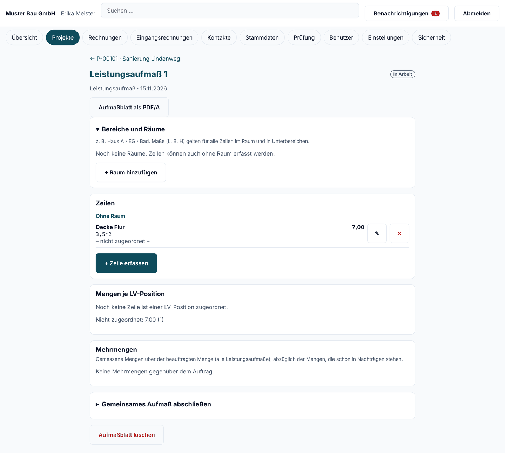
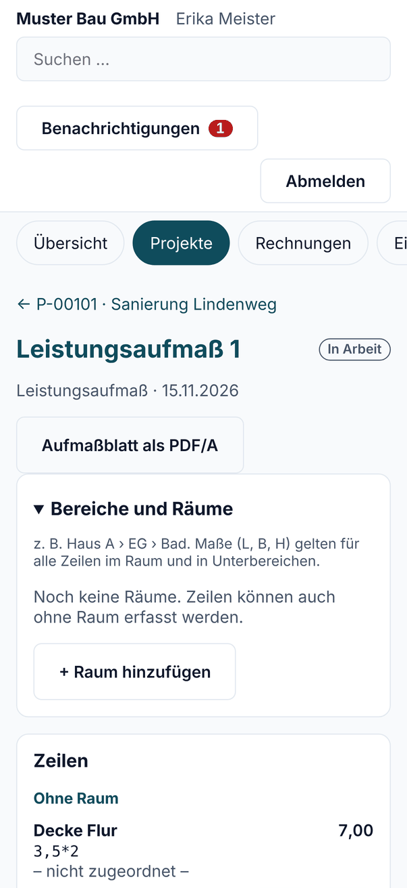

# 6. Aufmaß

Im Projekt unter **Aufmaß › Neues Aufmaßblatt**:

- **Angebotsaufmaß** – Mengen vor dem Angebot ermitteln,
- **Leistungsaufmaß** – ausgeführte Leistung, Grundlage für Rechnungen.

## Räume und Zeilen

1. **Raum hinzufügen** (z. B. „EG › Bad“) mit Länge, Breite und Höhe. Diese Maße stehen in den Formeln des Raums als `L`, `B` und `H` zur Verfügung.
2. **Zeile erfassen:** Raum und **LV-Position** wählen und eine **Formel oder Zahl** eingeben. Erlaubt sind deutsche Zahlen, Klammern und Variablen des Raums, z. B. `2*(L+B)*H` oder `3,50*2,75`. **Vorlagen** fügen fertige Formeln ein: Rechteck `L*B`, Raumumfang `2*(L+B)`, Wandfläche `2*(L+B)*H`, Dreieck, Trapez, Kreis `pi*R^2`.
3. **Abzug** für Türen und Fenster ankreuzen – die Zeile wird abgezogen.

Das Ergebnis erscheint sofort; EasyBau rechnet auf dem Server noch einmal nach.

## Mengen übernehmen

- **Mengen je LV-Position** zeigt gemessen, LV-Menge und Mehr-/Mindermenge (Hinweis bei mehr als 10 % Abweichung, VOB/B § 2 Abs. 3).
- **Mengen übernehmen in** Angebot oder Rechnung schreibt die gemessenen Mengen in das Dokument.
- **Nachtrag aus Mehrmengen anlegen** erzeugt aus den Mehrmengen ein Nachtragsangebot (Kapitel 8).

## Gemeinsames Aufmaß

**Gemeinsames Aufmaß abschließen:** Auftragnehmer und Auftraggeber unterschreiben direkt auf dem Gerät. Danach ist das Blatt gesperrt; Korrekturen nur mit einem neuen Blatt. **Aufmaßblatt als PDF/A** zum Weitergeben.

Aufmaßzeilen, die in einer festgeschriebenen Rechnung verwendet wurden, sind ebenfalls gesperrt.

Aufmaßzeilen lassen sich auch **ohne Netz** erfassen (Kapitel 7).
