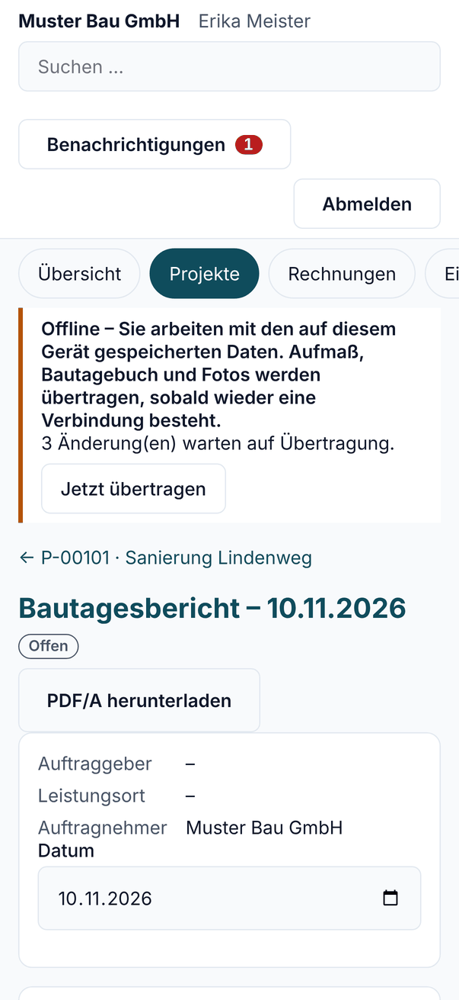
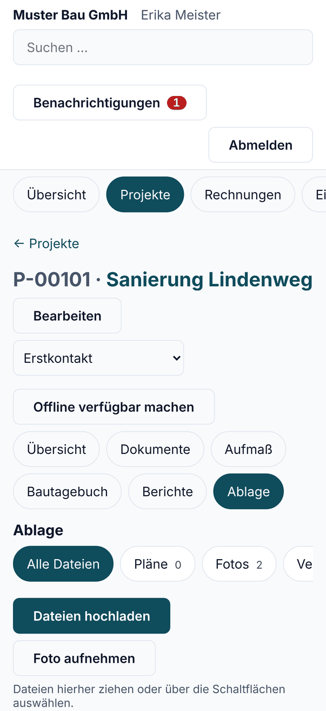

# 7. Auf der Baustelle

Alles in diesem Kapitel funktioniert auf dem Handy – und das Wichtigste auch ohne Netz.

## Bautagebuch

Im Projekt **Bautagebuch › Neuer Tagesbericht** (oder von der Übersicht **Bericht erfassen**):

- **Wetter** (Zustand, Temperatur), **Personal** mit Stunden je Person, **ausgeführte Leistungen**, **Material**, **Geräte**,
- **Vorkommnisse** (Behinderungen, Bedenken, Besuche) – daraus lassen sich direkt Folgedokumente anlegen, z. B. eine Behinderungsanzeige oder ein Nachtrag,
- **Fotos** direkt mit der Kamera, mit Bildunterschrift.

**Bericht speichern** sichert Zwischenstände; **Unterschreiben und abschließen** sperrt den Bericht. Unterschriebene Berichte sind Nachweise – z. B. für Nachträge oder Regiearbeiten.

## Weitere Berichte

Unter **Berichte › Neuer Bericht** wählen Sie die **Art des Berichts**:

| Bericht | Wofür |
|---|---|
| **Regiebericht** | Stundenlohnarbeiten mit Personal, Material, Geräten, Leistungszeitraum – lässt sich in eine Rechnung übernehmen |
| **Einsatzbericht** | Kundendienst- und Reparatureinsätze |
| **Abnahmeprotokoll** | Abnahme mit Mängeln und Unterschriften |
| **Bedenkenanzeige** / **Behinderungsanzeige** | schriftliche Anzeige nach VOB/B, mit Datum und Unterschrift |

Jeder Bericht lässt sich als **PDF/A** herunterladen.

## Unterschreiben

Unterschrieben wird mit Finger oder Stift direkt im Feld. Ihre eigene Unterschrift können Sie unter **Sicherheit › Meine Unterschrift** einmal hinterlegen und dann mit **Gespeicherte Unterschrift verwenden** einsetzen. Der Auftraggeber unterschreibt auf Ihrem Gerät.

## Ohne Netz arbeiten

1. **Vorher** (mit Netz): im Projekt **Offline verfügbar machen**.
2. **Auf der Baustelle**: Aufmaßzeilen, Bautagebuch und Fotos wie gewohnt erfassen. Oben zeigt eine Leiste, dass Sie offline sind und wie viele Änderungen warten.
3. **Wieder mit Netz**: Die Änderungen werden automatisch übertragen, oder **Jetzt übertragen**. Lehnt der Server eine Änderung ab, sehen Sie den Grund und können **Erneut versuchen** oder **Verwerfen**.

Ohne Netz nicht möglich: neue Aufmaßblätter und Räume, Unterschreiben, PDFs, Preise und Rechnungen. Bitte die App vor dem Abmelden einmal mit Netz öffnen, damit nichts liegen bleibt.

## Fotos und Pläne

**Ablage › Foto aufnehmen** oder **Dateien hochladen**; Ordner nach der Vorlage Ihrer Firma. Pläne (PDF) öffnen sich direkt im Browser.

