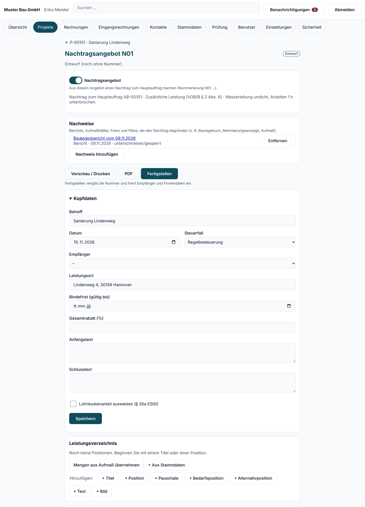

# 8. Nachträge

Ein Nachtrag ist ein Angebot zusätzlich zum Hauptauftrag (Auftragsbestätigung). Nur **beauftragte** Nachträge zählen zur Vertragssumme und dürfen abgerechnet werden.

## Nachtrag anlegen

- **Neues Dokument › Angebot**, dann den Schalter **Nachtragsangebot** einschalten, **Grund des Nachtrags** und **Begründung** angeben, **Umschalten**. Das Dokument heißt jetzt „Nachtragsangebot N01“, Positionen werden mit N01.1, N01.2 … nummeriert.
- Aus einem **Bautagesbericht** (Vorkommnis) direkt einen Nachtrag anlegen.
- Aus dem **Leistungsaufmaß**: **Nachtrag aus Mehrmengen anlegen** übernimmt die Mengen über der LV-Menge.

## Nachweise

Unter **Nachweise › Nachweis hinzufügen** hängen Sie Bautagesberichte, Aufmaßblätter oder Dateien aus der Ablage an – z. B. Fotos der angetroffenen Situation. Unterschriebene Berichte und Aufmaßblätter sind gesperrt und damit beweissicher.

## Entscheidung des Kunden

Nach **Fertigstellen** und Versand:

- **Beauftragt** – der ganze Nachtrag gilt,
- **Teilweise beauftragt** – die beauftragten Positionen ankreuzen und **Teilbeauftragung speichern**; nur diese zählen,
- **Abgelehnt**.

Projektmitglieder werden über die Entscheidung benachrichtigt; die **Vertragssumme** im Projekt aktualisiert sich.

## Mehr- und Mindermengen (VOB/B § 2 Abs. 3)

Im Leistungsaufmaß zeigt **Mehr- und Mindermengen** jede Vertragsposition, deren gemessene Menge mehr als 10 % von der beauftragten abweicht:

- **über 110 %:** Für die Menge über 110 % kann ein neuer Einheitspreis verlangt werden (§ 2 Abs. 3 Nr. 2). Der Nachtrag aus Mehrmengen übernimmt zunächst den bisherigen Preis – passen Sie ihn im Nachtrag an.
- **unter 90 %:** Steht die Menge endgültig fest, kann der Einheitspreis für die ausgeführte Menge erhöht werden (§ 2 Abs. 3 Nr. 3), etwa weil Baustellengemeinkosten nicht mehr gedeckt sind. EasyBau zeigt nur den Hinweis; die Preiserhöhung vereinbaren Sie per Nachtrag.

## Mehrmengen richtig abrechnen

Ist ein Mehrmengen-Nachtrag beauftragt, rechnet die Vertragsposition über das Aufmaß nur noch die gemessene Menge **abzüglich** der Nachtragsmenge ab – die Mehrmenge steht nur im Nachtrag. So wird nichts doppelt berechnet. Wurde die Mehrmenge schon vorher abgerechnet, enthält die nächste Rechnung an der Vertragsposition eine Korrekturmenge (negativ).
