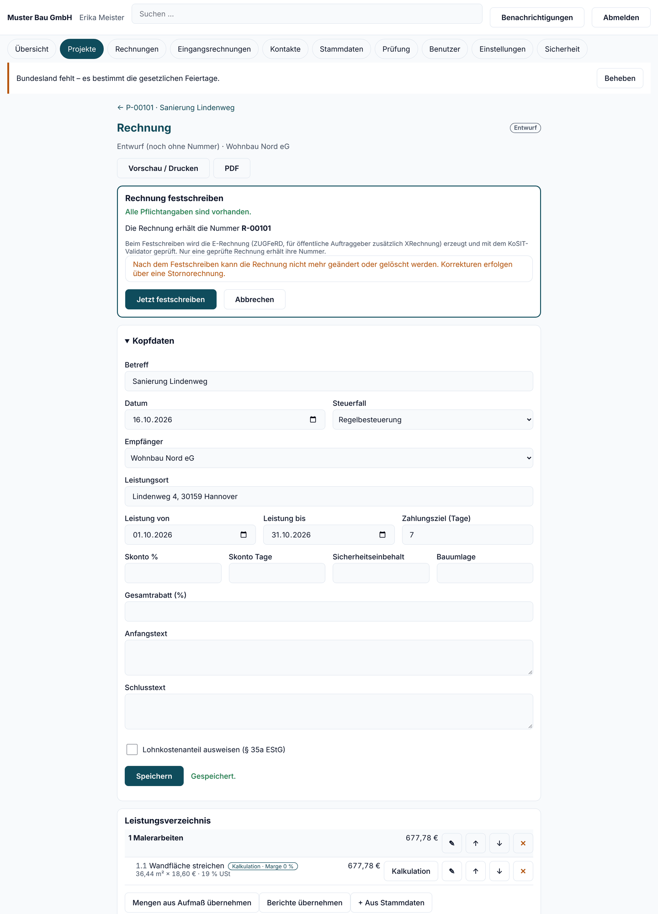
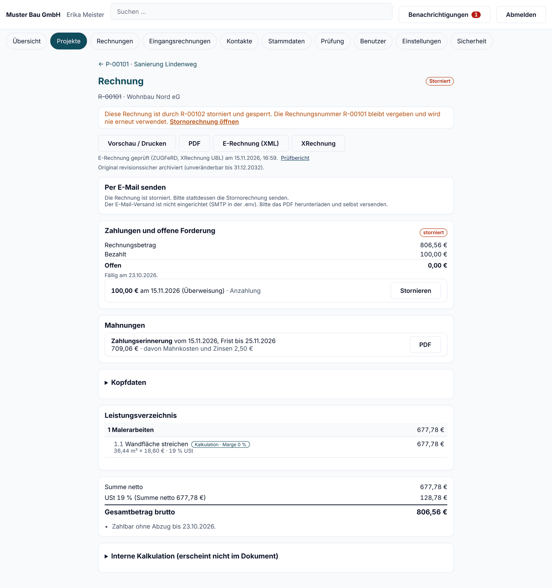
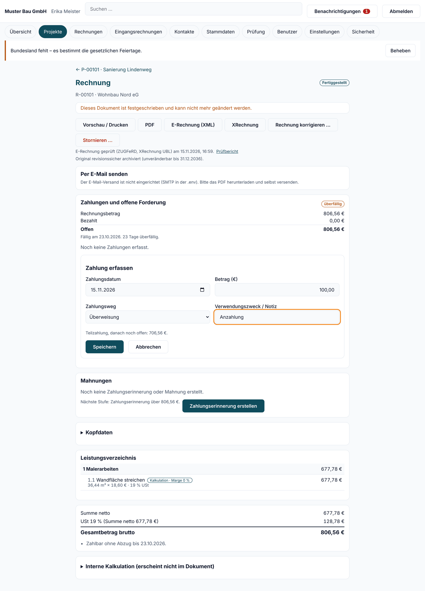
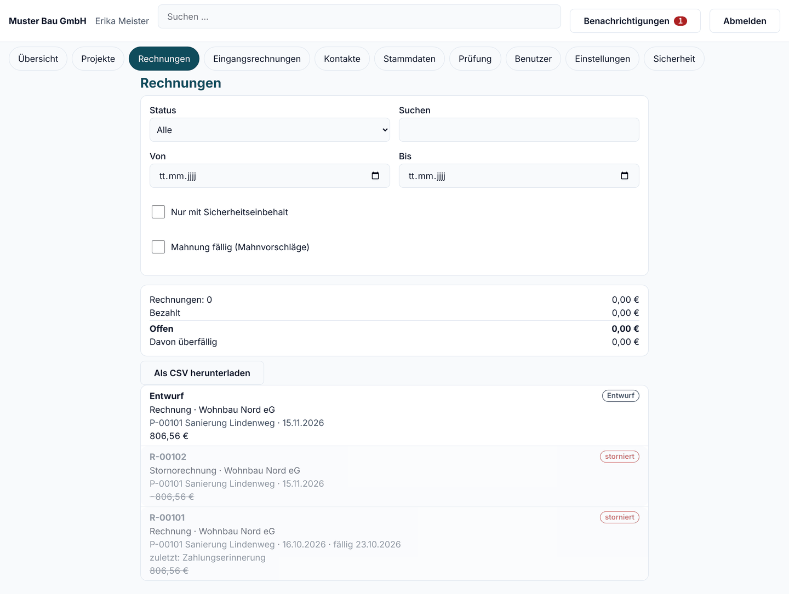
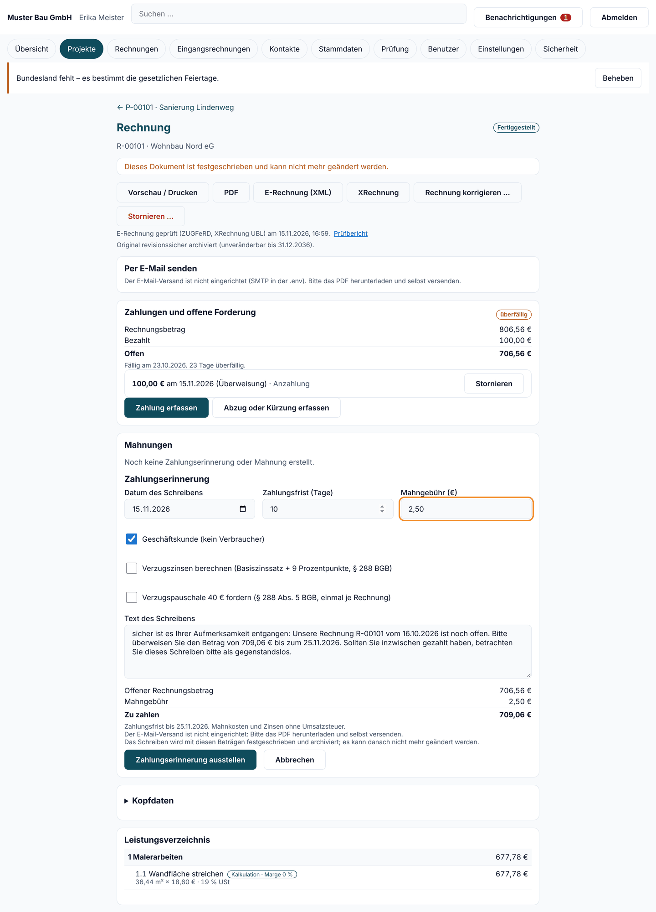

# 9. Rechnungen, Zahlungen, Mahnungen

## Rechnung erstellen

**Neues Dokument › Rechnung**, **Positionen übernehmen aus** der Auftragsbestätigung. Unter **Kopfdaten** die Rechnungsart wählen:

| Art | Wann |
|---|---|
| **Rechnung** | einmalige Abrechnung |
| **Abschlagsrechnung** | nach Baufortschritt; kumuliert (Gesamtleistung abzüglich bisheriger Abschläge) oder einzeln |
| **Teilrechnung** | abgeschlossener Teil der Leistung |
| **Schlussrechnung** | am Ende; zieht alle festgeschriebenen Abschlags- und Teilrechnungen ab (**Abschlagsaufstellung**) |

Weitere Felder: **Leistung von / bis** (Pflichtangabe), Zahlungsziel, Skonto, **Sicherheitseinbehalt**, **Bauumlage**, § 35a-Lohnkostenanteil.

- **Mengen aus Aufmaß übernehmen** setzt die Mengen aus dem Leistungsaufmaß (gemessen minus bisher abgerechnet).
- **Berichte übernehmen** holt unterschriebene Regieberichte mit ihren Stunden in die Rechnung. Leistungen, Material und Geräte kommen ohne Preis – bitte Preise eintragen.

## Festschreiben

**Rechnung festschreiben …** prüft vorher die Pflichtangaben nach § 14 UStG, die E-Rechnung und mögliche Fehler:

- **Fehler** (z. B. fehlende Steuernummer, Positionen aus nicht beauftragten Nachträgen, veraltete Aufmaßmengen) müssen behoben werden.
- **Hinweise** (z. B. Positionen ohne Preis, freie Positionen, Stundenlohnarbeiten) bestätigen Sie mit **Ich habe die Hinweise geprüft …**.

**Jetzt festschreiben** vergibt die Rechnungsnummer, erzeugt das PDF/A mit eingebetteter **E-Rechnung (ZUGFeRD)**, prüft sie mit dem offiziellen KoSIT-Prüfwerkzeug und archiviert alles revisionssicher. Für öffentliche Auftraggeber mit Leitweg-ID entsteht zusätzlich eine **XRechnung**. Ab jetzt ist die Rechnung unveränderlich.

## Stornieren und korrigieren

- **Rechnung korrigieren …** – storniert und legt sofort einen neuen Entwurf mit denselben Positionen an.
- **Stornieren …** – mit Grund; es entsteht eine **Stornorechnung** mit eigener Nummer.

Die stornierte Rechnung bleibt mit ihrer Nummer erhalten, ausgegraut und gesperrt. Nummern werden nie wiederverwendet.

## Zahlungen

An der Rechnung unter **Zahlungen und offene Forderung**:

- **Zahlung erfassen** – Datum, Betrag, Zahlungsweg. Bei Teilzahlung zeigt EasyBau den Rest.
- **Abzug oder Kürzung erfassen** – Skonto, Sicherheitseinbehalt, Bankgebühr, Kürzung (auch als **bestritten** markierbar).
- **Einbehalt ausgezahlt** – wenn der Sicherheitseinbehalt später kommt.
- Falsch erfasst? **Stornieren** bucht gegen; gelöscht wird nichts.

Auf der Rechnung steht ein **GiroCode** (QR-Code für Banking-Apps).

## Rechnungsliste

**Rechnungen** zeigt alle Rechnungen mit Status (offen, überfällig, angemahnt, bezahlt), Summen und Filtern, als **CSV** exportierbar. Mit dem Filter „Mahnung fällig (Mahnvorschläge)“ und **Mahnlauf starten** werden mehrere Mahnungen auf einmal erstellt.

## Mahnungen

An einer überfälligen Rechnung unter **Mahnungen**: **Zahlungserinnerung erstellen** → **1. Mahnung** → **Letzte Mahnung**. EasyBau schlägt Frist, Mahngebühr, **Verzugszinsen** (Basiszinssatz + 5 bzw. 9 Prozentpunkte, § 288 BGB) und bei Geschäftskunden die **Verzugspauschale** von 40 € vor. **… ausstellen** erzeugt das PDF/A; **Per E-Mail senden** verschickt es.

