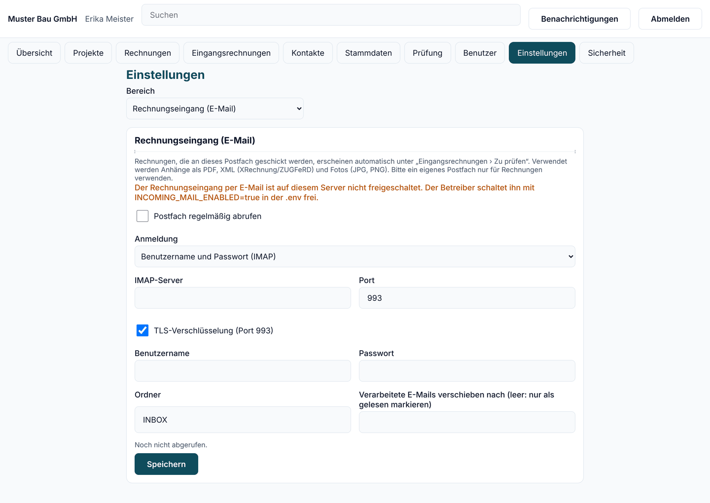
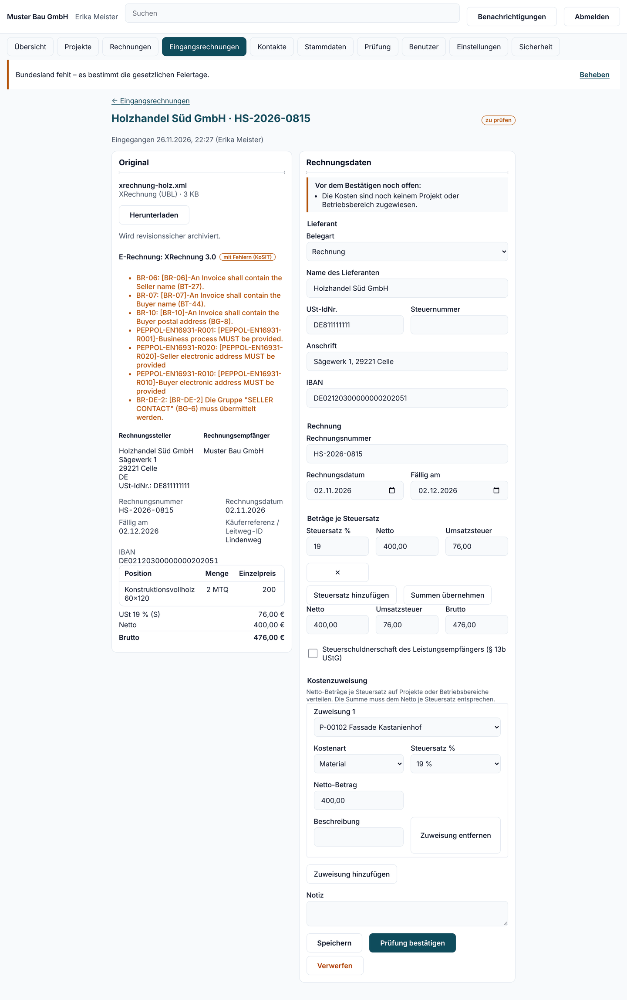

# 10. Eingangsrechnungen

Rechnungen Ihrer Lieferanten und Subunternehmer werden in EasyBau geprüft, auf Projekte verteilt und an den Steuerberater übergeben.

## Wie Rechnungen hereinkommen

- **Hochladen:** unter **Eingangsrechnungen** PDF, ZUGFeRD-PDF, XRechnung (XML) oder ein Foto der Papierrechnung.
- **Per E-Mail:** Ein eigenes Postfach (z. B. `rechnungen@ihre-firma.de`) wird regelmäßig abgerufen; jeder Rechnungsanhang landet in „Zu prüfen“. Einrichten unter **Einstellungen › Rechnungseingang (E-Mail)** – mit Benutzer und Passwort, mit **Microsoft 365** (App-Registrierung) oder mit **Google Workspace** (Dienstkonto). Die Schritte für Microsoft und Google stehen in der Betriebsdokumentation.

Unter **Einstellungen › Rechnungseingang (E-Mail)** steht außerdem das **Protokoll der abgerufenen E-Mails**: Absender, Betreff und für jeden Anhang, ob er als Eingangsrechnung übernommen wurde (mit Link), schon vorhanden war oder übersprungen wurde (z. B. Logo in der Signatur, AGB als Textdatei). Einträge werden nach 90 Tagen gelöscht; die Eingangsrechnungen selbst bleiben.

E-Rechnungen (ZUGFeRD/XRechnung) liest EasyBau automatisch: Lieferant, Rechnungsnummer, Datum, Beträge je Steuersatz und Positionen sind schon ausgefüllt und werden mit dem KoSIT-Prüfwerkzeug kontrolliert. Bei PDFs und Fotos tragen Sie die Daten neben der Vorschau ein.

## Prüfen und zuweisen

1. Lieferant, Rechnungsnummer, Datum, Fälligkeit und **Beträge je Steuersatz** prüfen (**Summen übernehmen** hilft).
2. **Kostenzuweisung:** **Zuweisung hinzufügen** – Projekt oder Betriebsbereich, Kostenart (Material, Lohn, Gerät, Fremdleistung, Sonstiges), Betrag. Bei E-Rechnungen mit Positionen auch **je Rechnungsposition zuweisen**. Zu- und Abschläge auf die ganze Rechnung (z. B. Rabatt, Fracht, Maut) verteilt EasyBau dabei anteilig auf die Positionen mit demselben Steuersatz, sodass die Summe stimmt; passt ein Zu- oder Abschlag zu keiner Position, bekommt er eine eigene Zeile, die Sie selbst zuweisen.
3. **Prüfung bestätigen.** Danach ist die Eingangsrechnung eingefroren; nur noch Zahlstatus und Storno sind möglich.

Fehlt noch etwas, zeigt EasyBau oben „Vor dem Bestätigen noch offen“.

- **Als bezahlt markieren**, wenn die Rechnung bezahlt ist.
- **Verwerfen** für Dubletten oder Werbung; nichts wird gelöscht.
- Die Kosten erscheinen in den **Kennzahlen** des Projekts.
- Lieferanten bekommen im Kontakt eine **Kreditorennummer**; DATEV bucht dann auf dieses Personenkonto. Die Nummer tragen Sie selbst ein oder lassen sie mit **Kreditorennummer aus dem Nummernkreis vergeben** ziehen (Nummernkreis „Kreditoren“ unter **Einstellungen › Nummernkreise**, Standard ab 70001). Unter **Einstellungen › DATEV** lässt sich einschalten, dass Lieferanten ohne Nummer beim **Prüfung bestätigen** automatisch eine bekommen.
