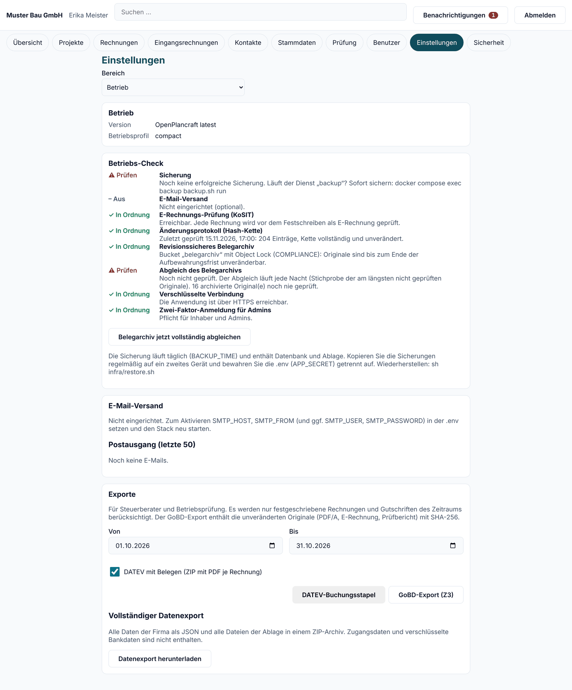

# 11. Exporte, Prüfung, Sicherheit

## Exporte für Steuerberater und Finanzamt

Unter **Prüfung › Exporte** (bzw. **Einstellungen**) für einen Zeitraum:

| Export | Inhalt |
|---|---|
| **DATEV** | Buchungsstapel für Ausgangsrechnungen, Zahlungen, Eingangsrechnungen, mit den Belegen (PDF/XML) |
| **GoBD (Z3)** | Datenträgerüberlassung für die Betriebsprüfung: Tabellen, `index.xml`, alle Belege |
| **Vollexport** | alle Daten der Firma als JSON plus alle Dateien der Ablage, z. B. für einen Umzug |

## Prüfung (Änderungsprotokoll)

Jede Änderung an steuerrelevanten Daten wird protokolliert – wer, wann, was vorher, was nachher – und mit einer Hash-Kette gegen nachträgliche Änderung gesichert. **Kette jetzt prüfen** prüft sofort; EasyBau prüft zusätzlich jede Nacht.

### Zugang für Steuerberatung oder Betriebsprüfer

**Benutzer › Person einladen** mit der Rolle **Steuerberatung / Prüfer (nur lesen)** und einem Datum bei **Zugang bis** (höchstens ein Jahr). Der Prüfer sieht alles, ändert nichts und kann exportieren. Nach Ablauf endet der Zugang automatisch.

## Belegarchiv

Festgeschriebene Rechnungen, Mahnungen, E-Rechnungen, Eingangsrechnungen und fertige Angebote werden unveränderbar archiviert (WORM, gesperrt bis zum Ende der Aufbewahrungsfrist von 6 bzw. 10 Jahren). An jedem Dokument steht „Original revisionssicher archiviert (unveränderbar bis …)“.

## Betriebs-Check

**Einstellungen › Betrieb** zeigt auf einen Blick, ob der Betrieb in Ordnung ist:

- **Sicherung** – letzte nächtliche Sicherung von Datenbank und Dateien,
- **Sicherung außer Haus** – verschlüsselte Kopie an einem zweiten Ort (sonst Warnung),
- **E-Mail-Versand**, **E-Rechnung (KoSIT)**, **Änderungsprotokoll**, **Belegarchiv** mit nächtlichem Abgleich,
- **HTTPS** und **Zwei-Faktor-Pflicht für Administratoren**.

Gelbe oder rote Einträge bitte an Ihren Administrator weitergeben.

