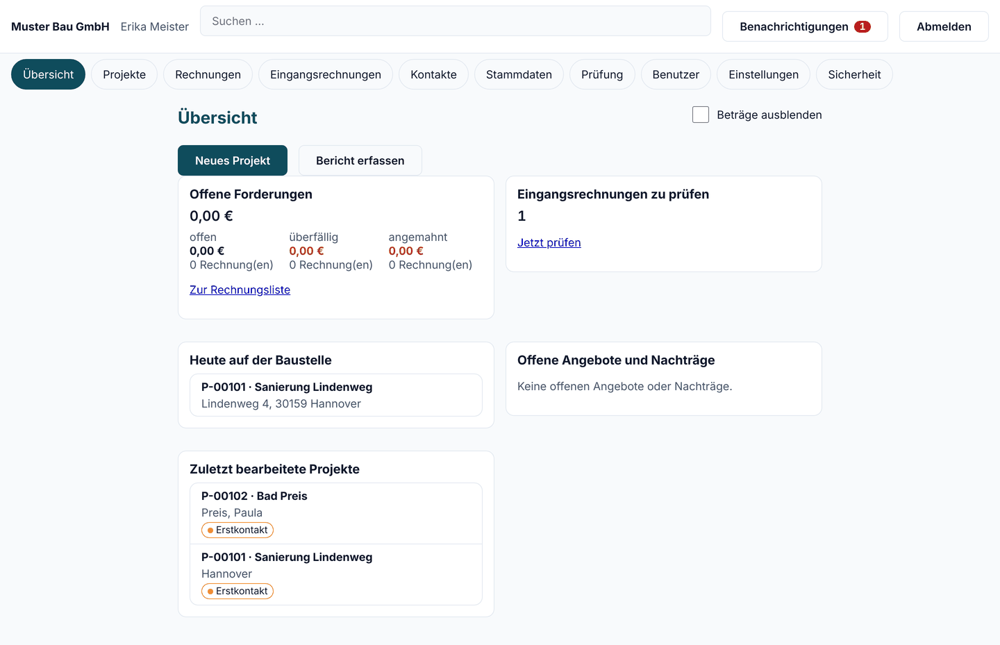

# EasyBau – Benutzerhandbuch

EasyBau ist die Betriebssoftware für Bau- und Handwerksbetriebe: Kunden, Projekte, Angebote mit Kalkulation, Aufmaß, Bautagebuch, Rechnungen mit E-Rechnung, Zahlungen und Mahnungen, Eingangsrechnungen und die Exporte für Steuerberater und Finanzamt – in einem Programm, das im Büro am Rechner und auf der Baustelle am Handy läuft.

Dieses Handbuch beschreibt die Bedienung. Für die Installation und den Betrieb des Servers gibt es die [Betriebsdokumentation](../self-hosting/README.md).

## Inhalt

| Kapitel | Für wen | Worum es geht |
|---|---|---|
| [1. Erste Schritte](01-erste-schritte.md) | alle | Anmelden, zweiter Faktor, Aufbau der Oberfläche, Suche, Benachrichtigungen |
| [2. Einrichten](02-einrichten.md) | Inhaber, Büro | Firmendaten, Briefpapier, Nummernkreise, Lohngruppen, Benutzer und Rollen |
| [3. Kontakte und Stammdaten](03-kontakte-stammdaten.md) | Büro | Kunden, Lieferanten, Leistungen, Materialien, DATANORM, CSV-Import |
| [4. Projekte](04-projekte.md) | alle | Projekt anlegen, Ablage, Kennzahlen, Vertragssumme |
| [5. Angebot und Auftrag](05-angebot-auftrag.md) | Büro | Leistungsverzeichnis, Kalkulation, Zielpreis, Versionen, Versand, Auftragsbestätigung |
| [6. Aufmaß](06-aufmass.md) | Baustelle, Büro | Aufmaßblätter, Formeln, Mengen übernehmen, gemeinsames Aufmaß |
| [7. Auf der Baustelle](07-baustelle.md) | Baustelle | Bautagebuch, Berichte, Fotos, Unterschrift, offline arbeiten |
| [8. Nachträge](08-nachtraege.md) | Büro, Bauleitung | Nachtragsangebot, Nachweise, Mehrmengen, Teilbeauftragung |
| [9. Rechnungen, Zahlungen, Mahnungen](09-rechnungen.md) | Büro | Abschlags- und Schlussrechnung, Festschreiben, E-Rechnung, Storno, Zahlungen, Mahnwesen |
| [10. Eingangsrechnungen](10-eingangsrechnungen.md) | Büro | Hochladen, E-Mail-Postfach, prüfen, auf Projekte verteilen |
| [11. Exporte, Prüfung, Sicherheit](11-exporte-pruefung.md) | Inhaber, Steuerberater | DATEV, GoBD, Prüferzugang, Belegarchiv, Betriebs-Check |
| [12. Häufige Fragen](12-faq.md) | alle | Kurze Antworten auf typische Fragen |

## Wichtige Grundsätze in EasyBau

- **Entwurf → fertig → festgeschrieben.** Angebote und Aufträge werden *fertiggestellt*, Rechnungen *festgeschrieben*. Danach bekommen sie ihre Nummer und lassen sich nicht mehr ändern (GoBD). Eine falsche Rechnung wird storniert und neu erstellt – die Nummer bleibt vergeben.
- **Nichts geht verloren.** Festgeschriebene Belege werden revisionssicher archiviert, Zahlungen nicht gelöscht, sondern gegengebucht. Jede Änderung steht im Änderungsprotokoll.
- **Baustelle zuerst.** Alle Seiten funktionieren auf dem Handy; Aufmaß, Bautagebuch und Fotos auch ohne Netz.
- **Rechte je Rolle.** Wer auf der Baustelle arbeitet, sieht keine Preise und Forderungen; das Büro sieht alles, ein Steuerprüfer nur lesend und befristet.
